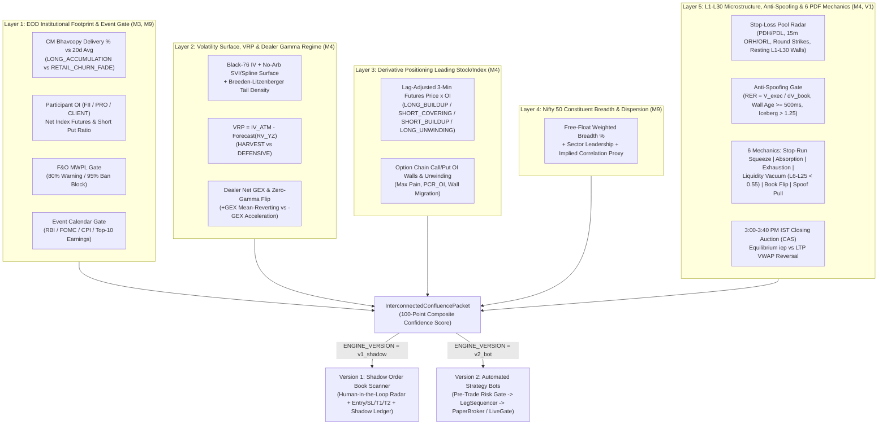

# Retail Quant Engine — Interconnected World & Work Ledger (`M0–M13`)

> **Status correction (10 Nov 2026 review, see [`REVIEW_2026-11-10.md`](REVIEW_2026-11-10.md)):** "BUILT" below means the code exists. No milestone after M0 meets its SPEC §13 acceptance criteria yet: these need recordings, the reference logs, contract notes, paper sessions and a static IP.
> - **Not working yet:** the Upstox adapter now has a real socket but has not yet run live. Its `full_d30` mode needs Upstox Plus, which is free to switch to but costs ₹30 instead of ₹20 per executed order. The "backtester" stress-tests hand-written trade lists; there is no replay of recorded data. Constituent weights are hand-typed, not point-in-time.
> - **Demo-only commands:** `shadow-scan`, `report`, `backtest`, `paper` and `self-review` (without `FILE=`) only have synthetic inputs, so they now require `DEMO=1`.

> **Version 1 (`v1_shadow` — Default)**: **Human-in-the-Loop "Shadow Order Book" Scanner & Forward-Testing Ledger** (100% read-only; zero automated orders).
> **Version 2 (`v2_bot` — Switchable)**: **Automated Execution Bots** consuming the exact same 5-Layer Interconnected Confluence Packet, gated by `check_pre_trade_risk_gate`, `LegSequencer`, `OpsLimiter`, and `live_gate()`.

---

## 1. Complete Work Ledger (Every Feature & Milestone Built)

| Milestone / Layer | Built Modules | Key Capabilities & Mechanics Implemented |Status |
| :--- | :--- | :--- | :--- |
| **M0 — Foundations, Rules & Config** | `engine/core/config.py`, `engine/core/rules.py`, `config/settings.yaml`, `config/rules/*.csv` | Versioned CSV rule loader (`lots.csv`, `expiry_rules.csv`, `margin.csv`, `stt.csv`, `brokerage.csv`), `EngineVersion` (`v1_shadow` vs `v2_bot`), `ShadowScannerConfig`, `load_settings(version=...)`. | **BUILT** |
| **M1 — Trade-Log Mining & Self-Review** | `engine/trade_mining/parse_report.py`, `validate.py`, `self_review.py`, `reverse_engineer.py` | Normalizes Zerodha/Upstox/Fyers tradebooks (`parse_tradebook_csv`), reconciles contract notes (`reconcile_contract_note`), computes behavioral leakage (`holding_bucket_metrics`, `detect_revenge_sizing`, `compute_cost_drag`, `generate_self_review_report`), and reconstructs MFE/MAE & historical setups (`reverse_engineer_trades`). | **BUILT** |
| **M2 — Tick/Bar Recorder & Adapters** | `engine/data/adapters/upstox.py`, `fyers.py`, `sim.py`, `base.py`, `engine/data/recorder.py` | Upstox API V3 adapter (`UpstoxFeed`, `parse_upstox_v3_feed`, `build_upstox_sub_frame`, `resolve_upstox_token`) supporting **30-level depth (`full_d30`)**, native Option Greeks (`iv, delta, gamma, theta, vega, rho`), Closing Auction Session (`iep`, `iiqTotal`), and 1-year `UPSTOX_ANALYTICS_TOKEN`. | **BUILT** |
| **M3 — EOD Pipeline (Bhavcopy, Participant OI & Corporate Actions)** | `engine/data/eod/bhavcopy.py`, `participant_oi.py`, `engine/data/reference/corporate_actions.py` | NSE CM Delivery % & Relative Delivery Ratio vs 20-day mean (`DeliveryBias`: `LONG_ACCUMULATION`, `RETAIL_CHURN_FADE`), F&O Bhavcopy with MWPL 80% early-warning & 95% ban hard-block (`MWPLStatus`), Participant OI (`FII`, `DII`, `PRO`, `CLIENT` net index futures & options sentiment), ex-date dividend strip & split/bonus strike/lot adjuster. | **BUILT** |
| **M4 — Analytics Core & L1–L30 Order-Flow Engine** | `engine/analytics/forward.py`, `parity.py`, `iv.py`, `surface.py`, `density.py`, `greeks.py`, `exposures.py`, `realized_vol.py`, `vrp.py`, `positioning.py`, `technicals.py`, `microstructure.py`, `order_flow.py` | Forward & Put-Call Parity implied forward/borrow, Black-76 Newton+Brent IV solver, SVI / cubic-spline surface with butterfly & calendar no-arb checks, Breeden–Litzenberger risk-neutral PDF & crash prob, analytical Greeks, Dealer GEX / Zero-Gamma Flip / Pin Strike / Vanna / Charm, Parkinson/Garman-Klass/Rogers-Satchell/Yang-Zhang RV, VRP Z-score, Lag-Adjusted 4-Quadrant Futures OI Buildup, ORB/Anchored-VWAP/3PM CAS VWAP, L1–L30 Microprice/OBI/OFI/CVD/VPIN/Air-Pocket, Anti-Spoofing RER, and **6 PDF Order-Flow Mechanics**. | **BUILT** |
| **M5 — Paper Broker, Order FSM & Leg Sequencer** | `engine/execution/order_fsm.py`, `ops_limiter.py`, `leg_sequencer.py`, `paper_broker.py`, `slicer.py` | Deterministic `OrderFSM` (`LIMIT` & `MARKET_PROTECTED` only; plain `MARKET` forbidden), token-bucket `OPSRateLimiter` (`< 8 OPS`, below SEBI's 10 OPS threshold), 2-stage `LegSequencer` (protective long wings must fill before short risk legs, with automatic `MARKET_PROTECTED` flatten via `emergency_flatten_filled_hedges` on timeout), `PaperBroker` depth-walk simulator, and freeze-quantity `slicer`. | **BUILT** |
| **M6 — Replay Backtester, Walk-Forward, Monte Carlo & DSR** | `engine/backtest/replay.py`, `walkforward.py`, `montecarlo.py`, `deflated_sharpe.py`, `costs.py` | Event-driven `run_backtest_with_stress` with **2x slippage stress** & **+50 ms latency injection**, rolling `generate_walk_forward_splits` & `evaluate_walk_forward`, 1,000-path block bootstrap `run_monte_carlo_bootstrap`, and Bailey–López de Prado `probabilistic_sharpe_ratio` & `deflated_sharpe_ratio` (DSR). | **BUILT** |
| **M7 — Strategy 1: Defined-Risk Weekly Nifty Iron Condor** | `engine/strategies/iron_condor.py` | Trades only when `VRP` is elevated (`ELEVATED_HARVEST`), Dealer `GEX > 0` (`POSITIVE_GAMMA_PINNING`), and no tier-1 event blackout exists; places short strikes outside `1.2x` expected move with protective wings sequenced first. | **BUILT** |
| **M8 — Risk Layer, Empirical Quarter-Kelly & Microstructure Stops** | `engine/risk/kelly.py`, `limits.py`, `stops.py`, `kill_switch.py`, `attribution.py` | Empirical `quarter_kelly_fraction` (`0.25x`, clamped `[0, 1.5%]`), `check_pre_trade_risk_gate` (reads `settings.risk`: `block_first_minutes: 15`, `per_trade_max_loss_pct: 2.5%` directional / `5.0%` spread, `daily_loss_limit_pct: 2.0%`, `weekly_loss_limit_pct: 5.0%`, `max_open_risk_pct: 10.0%`, `50%` margin headroom), **Delta-Flip Stop** + **Momentum Half-Life Time-Decay Stop** + **Consecutive-Loss Circuit Breaker** (`evaluate_microstructure_exit`), `KillSwitch` (`MARKET_PROTECTED` short-first flatten), and Greek + execution slippage `decompose_trade_pnl`. | **BUILT** |
| **M9 — Nifty 50 Constituent Breadth & Macro/Earnings Calendar** | `engine/data/constituents/nifty_members.py`, `engine/data/events/event_calendar.py` | Survivorship-bias-free `point_in_time_constituents`, free-float-weighted breadth (`compute_constituent_breadth`), cross-sectional dispersion & implied correlation proxy, and `evaluate_event_risk` blackout/size-scaling around RBI MPC, CPI, Fed FOMC, Budget, and Top-10 heavyweight earnings. | **BUILT** |
| **M10 — Strategy 2: Defined-Risk Intraday Directional Spread** | `engine/strategies/directional_intraday.py` |Requires alignment across **Futures 4-Quadrant OI Buildup + Constituent Breadth + L1–L30 Order-Flow Signal** (`score >= 70`) and maps to a defined-risk vertical debit spread (long ATM + short OTM wing). | **BUILT** |
| **M11 — Strategy 3: Opening Range Breakout + Options Confirmation** | `engine/strategies/opening_breakout.py` | 15-minute ORB breakout filtered by `Real Execution Ratio (RER >= 0.70)`, Option Chain Call/Put wall unwinding (`PCR_OI`), and constituent breadth confirmation. | **BUILT** |
| **M12 — Broker Position Reconciler & Live Gate** | `engine/execution/reconcile.py`, `engine/core/config.py` | `reconcile_positions` detects qty mismatches, orphan broker positions, and missing local positions, automatically tripping `KillSwitch` on critical drift; `resolve_execution_route` enforces `live_gate()` (all 5 preconditions required). | **BUILT** |
| **M13 — Optional Sleeves, Order-Flow Bots & Sidecar** | `engine/strategies/optional_sleeves.py`, `order_flow_bots.py`, `sidecars/event_arb/` | Event/Term-Structure Calendar Spread (`evaluate_calendar_spread`), Cash Equity Swing with Delivery % + Anchored VWAP (`evaluate_cash_swing_delivery`), Expiry-Day Gamma Breakout (`evaluate_expiry_gamma_breakout`), Order-Flow Bot dispatcher (`dispatch_shadow_or_bot_signal`), and SEBI Tender-Offer Buyback Sidecar. | **BUILT** |
| **Version 1 — Shadow Order Book Scanner & Dashboard** | `engine/shadow/models.py`, `scanner.py`, `report.py`, `engine/confluence/engine.py` | Up to 50-symbol L1–L30 radar, 100-Point Composite Confidence Formula, Stop-Pool Radar (`PDH/PDL`, `15m ORH/ORL`, Round Numbers, Resting Walls), Microstructure SL & T1/T2 calculator, forward-testing Shadow Ledger, and XSS-safe HTML dashboard (`reports/shadow_scanner/YYYY-MM-DD.html`). | **BUILT** |

---

## 2. How the Interconnected System Operates (5-Layer Cross-Asset Confluence)

Instead of treating cash equities, futures, options, and L1–L30 order book depth as isolated silos, [`evaluate_interconnected_confluence`](file:///d:/Trading/engine/confluence/engine.py#L84-L234) fuses all 5 layers into a single [`InterconnectedConfluencePacket`](file:///d:/Trading/engine/confluence/engine.py#L43-L64):



### How Derivative Moments Lead Stock/Index Entry Decisions

1. **Short-Covering Squeeze Confirmation (`STOP_RUN_SHORT_SQUEEZE` + Futures OI Drop + Call-Wall Unwinding)**:
   - When price breaks above `PDH` or `15m ORH` (or reclaims `PDL` after a Wyckoff Spring sweep), **retail traders wait for candle closes** while **NSE's 3-minute snapshot OI lags real-time tape**.
   - Our engine combines **instantaneous L1–L30 tape (`RER >= 0.75`, positive `CVD` Z-score, L6–L25 overhead `Air-Pocket ratio < 0.55`)** with **3-minute Futures `SHORT_COVERING` (`Price Up + OI Down` as trapped shorts buy to cover)** and **Option Chain Call-Wall OI unwinding (`call_oi_change < 0` at the overhead strike)**.
   - When all three align, `derivative_leads_stock_direction` flips to `BULLISH_LEAD`, boosting Pillar 4 (`cross_asset_derivative_pts`) up to `20/20` and elevating the setup to `A_PLUS` (`>= 80/100`).
2. **Dealer Gamma Regime (`GEX`) Governs Strategy Selection & Target Projection**:
   - **Positive Dealer GEX (`Net GEX > 0`, spot above Zero-Gamma Flip)**: Dealers are net long gamma and sell rips / buy dips to stay delta-neutral. This **dampens realized volatility**, making **M7 Weekly Iron Condor** (`evaluate_iron_condor`) and **fade/reclaim waves (`STOP_HUNT_RECLAIM`, `INITIATIVE_EXHAUSTION_FADE`)** high-probability while blocking breakout-chasing.
   - **Negative Dealer GEX (`Net GEX < 0`, spot below Zero-Gamma Flip)**: Dealers are net short gamma and must hedge *in the same direction* as price movement (buying futures as price rises, selling as price falls). This **amplifies momentum cascades** through L6–L25 liquidity vacuums, enabling **Wall Breakout Squeezes (`WALL_BREAKOUT_SQUEEZE`)** and **M13 Expiry Gamma Breakouts (`evaluate_expiry_gamma_breakout`)** while **automatically blocking Iron Condors**.
3. **EOD Relative Delivery % Separates Institutional Accumulation from Retail Intraday Churn**:
   - A stock breaking out on high intraday volume with **low prior-day Relative Delivery (`< 0.65x` 20-day mean, `RETAIL_CHURN_FADE`)** is flagged as fragile retail churn.
   - Conversely, **`LONG_ACCUMULATION` (`Relative Delivery >= 1.35x` 20-day mean + positive close)** confirms multi-day institutional absorption, unlocking **`VWAP_DELIVERY_RECLAIM`** and **M13 Cash Equity Swing (`evaluate_cash_swing_delivery`)**.
4. **Anti-Spoofing Filter (`RER`) Protects Every Entry Against Phantom Orders**:
   - Before any signal is graded `A_PLUS` or `B_TIER`, [`evaluate_anti_spoofing`](file:///d:/Trading/engine/analytics/order_flow.py#L61-L133) computes the **Real Execution Ratio**:
     $$\text{RER} = \frac{V_{\text{executed at wall price}}}{\max(1, -\Delta V_{\text{resting wall}})}$$
   - If a large resting wall disappears with `< 20%` actual traded volume ($\text{RER} < 0.20$), it is classified as `SPOOF_LIQUIDITY_PULL` (`ShadowSignalStatus.BLOCKED_SPOOF`), its Pillar 2 flow score is zeroed out, and both Version 1 and Version 2 block the entry.
   - If $\text{RER} > 1.25$ (more volume executes at the level than was visibly displayed), hidden **Iceberg Reloading** (`is_iceberg_reload=True`) is flagged and rewarded.

---

## 3. Switching Between Version 1 (`v1_shadow`) and Version 2 (`v2_bot`)

Both versions share the **exact same data adapters, analytics core, L1–L30 order-flow engine, and 100-Point Confluence Packet**. You can switch seamlessly via configuration, environment variable, or CLI argument:

### Option A — CLI Argument (`tasks.py`)
```powershell
# Run Version 1: Human-in-the-Loop Shadow Order Book Scanner (Default)
d:\Trading\.venv\Scripts\python.exe tasks.py shadow-scan

# Run Version 2: Automated Strategy Bot in Paper Mode
d:\Trading\.venv\Scripts\python.exe tasks.py paper VERSION=v2_bot
```

### Option B — Environment Variable (`ENGINE_VERSION`)
```powershell
$env:ENGINE_VERSION = "v1_shadow"   # Version 1: Read-only Shadow Scanner
$env:ENGINE_VERSION = "v2_bot"      # Version 2: Automated Strategy Execution Bot
```

### Option C — `config/settings.yaml`
```yaml
engine_version: v1_shadow   # Change to v2_bot when ready to run automated bots
```

### What Changes When You Switch?

| Behavior | Version 1 (`v1_shadow` — Default) | Version 2 (`v2_bot`) |
| :--- | :--- | :--- |
| **Order Placement** | **Zero orders placed.** `StrategyDecision.stage1_hedge_legs` and `stage2_risk_legs` are always empty `()`. | Emits executable `SpreadLegIntent` orders routed via `LegSequencer` and `OpsLimiter`. |
| **Signal Output** | Generates `ShadowSignal` with Entry, microstructure SL (behind L1–L15 wall), T1/T2 (in front of L10–L30 wall), Quarter-Kelly qty, and plain-English rationale. | Consumes `InterconnectedConfluencePacket` across M7, M10, M11, M13 & Order-Flow Bots. |
| **Forward Testing** | Every `A_PLUS` / `B_TIER` signal is tracked tick-by-tick in the **Shadow Ledger** (`ShadowOrderBookScanner.closed_outcomes`) for MFE, MAE, R-multiple, and net PnL after SEBI/NSE charges. | Executes in `PaperBroker` (Mode A/B) or `LiveBroker` (only when `live_gate()` passes all 5 preconditions). |
| **Microstructure Exit Radar** | Displays live warnings if an active shadow setup suffers a **Delta-Flip (`CVD_Z` + `OBI_L5` reversal)** or **Momentum Half-Life stall**. | Automatically triggers `evaluate_microstructure_exit` to flatten positions before hard SL is hit. |

---

## 4. Upstox Free API V3 vs. Zerodha Paid API (`₹500/mo`) vs. Dhan (`₹499+GST/mo`)

### Why Upstox Free API V3 Is Strictly Superior for Version 1 (`v1_shadow`) & Deep-Book Order Flow

| Capability | **Upstox API V3 (Primary Recommended)** | **Zerodha Kite Connect (`₹500/mo`)** | **DhanHQ Data API (`₹499+GST/mo`)** |
| :--- | :--- | :--- | :--- |
| **Monthly API Subscription** | **₹0 / month** (Free for all Upstox account holders) | **₹500 / month** (`Kite Connect` paid tier; `Kite Personal` is free for orders only, **no market data WebSocket**) | **₹499 + GST / month** for Data APIs (Order APIs are free) |
| **L2 / L3 Market Depth Levels** | **30-Level Depth (`full_d30` mode)** over V3 Protobuf WebSocket (up to 50 instruments on Upstox Plus) | **5-Level Depth (`modeFull`) ONLY** via API (20-level depth is restricted to the Kite web UI and **not** exposed on standard Kite Connect API) | **20-Level Depth** (and 200-level full depth on select feed tiers) |
| **Read-Only Token Validity** | **1-Year `UPSTOX_ANALYTICS_TOKEN`** (zero daily 2FA login, zero order-placement risk — purpose-built for scanners!) | **24-Hour `access_token` only** (requires daily TOTP/2FA login every morning before 09:15 IST) | 24-Hour token / static IP token options |
| **Native Option Greeks in Stream** | **Yes (`optionGreeks`: `iv, delta, gamma, theta, vega, rho`)** + Closing Auction (`iep`, `iiqTotal`) in `full` / `full_d30` | **No** (must compute all Greeks locally from LTP) | Yes (via Option Chain API) |
| **Max Symbols per WebSocket** | `ltpc`: 5,000 \| `full` (5-lvl): 500 \| `full_d30` (30-lvl): **50 symbols** | **3,000 symbols** per WebSocket (`modeFull` 5-level) across up to 3 connections (9,000 total) | Up to 5,000 symbols (5-level) / 50 symbols (20-level) |
| **Execution Brokerage** | ₹20 or 2.5% (whichever is lower) on Equity Delivery & F&O | ₹0 Equity Delivery, ₹20 or 0.03% Intraday/F&O (plus ₹500 API fee waiver if monthly brokerage > ₹500) | ₹0 Equity Delivery, ₹20 or 0.03% Intraday/F&O |

### Does Zerodha Have Any Upper Hand at All?
Zerodha has **no advantage for L6–L30 deep order-book scanning** (because its API is capped at 5 depth levels and costs ₹500/mo), **except** in three narrow scenarios:
1. **Broad 5-Level Universe Breadth (>500 symbols simultaneously)**: A single Kite Connect WebSocket streams 5-level depth for **3,000 instruments** (`9,000` across 3 sockets), whereas Upstox V3 `full` (5-level) caps at `500` instruments (`full_d30` caps at `50`). However, our Upstox V3 adapter solves this cleanly by using `ltpc` (up to `5,000` symbols) for broad Nifty 50 constituent breadth while reserving the `50` `full_d30` slots for active F&O / stock setups!
2. **Existing Capital / Single-Account Collateral Convenience**: If a trader already holds pledged liquid ETFs/G-Secs/equity collateral in Zerodha and generates `> ₹500/month` in brokerage, Zerodha currently rebates the ₹500 Kite Connect fee, and executing in the same account avoids splitting margin across two brokers.
3. **Zero Equity Cash Delivery Brokerage**: For **M13 Cash Equity Swing (`evaluate_cash_swing_delivery`)**, Zerodha charges `₹0` brokerage on cash delivery whereas Upstox charges `min(₹20, 2.5%)` per order (capped at ₹20).

**Recommended Hybrid Setup (Implemented Out-of-the-Box)**:
- Use **Upstox API V3 (`UPSTOX_ANALYTICS_TOKEN` + `full_d30`)** at **₹0/month** as your primary L1–L30 Shadow Order Book Scanner & Analytics feed (`Version 1` & `Version 2`).
- In `Version 2`, execute either via Upstox (`₹0` API cost) or whichever broker holds your pledged margin collateral (`config/rules/brokerage.csv` parameterizes `upstox`, `zerodha`, `fyers`, and `dhan` side-by-side).
